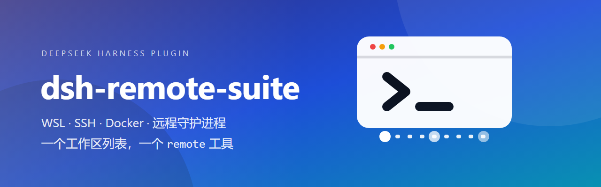
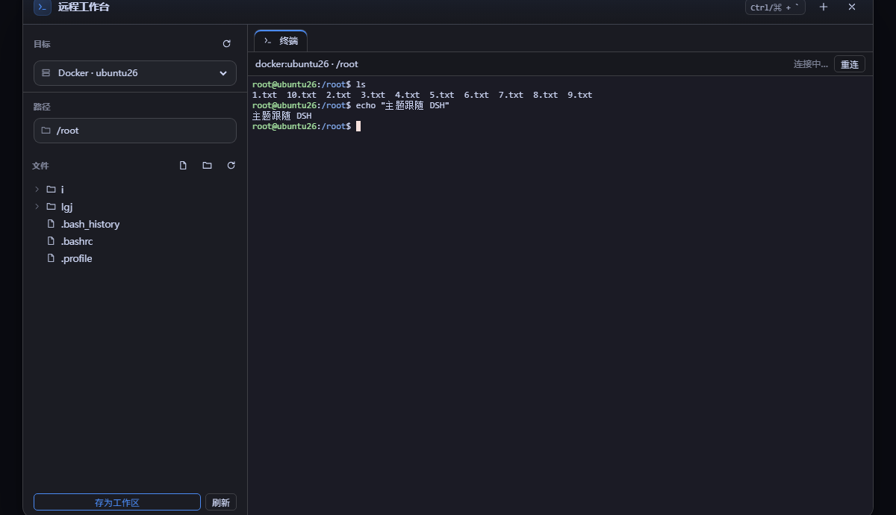
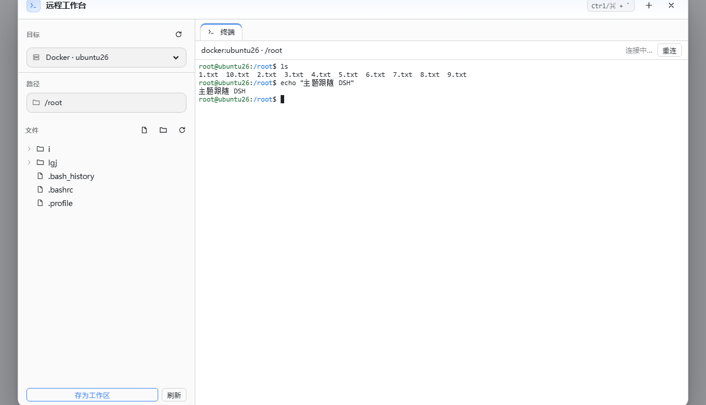
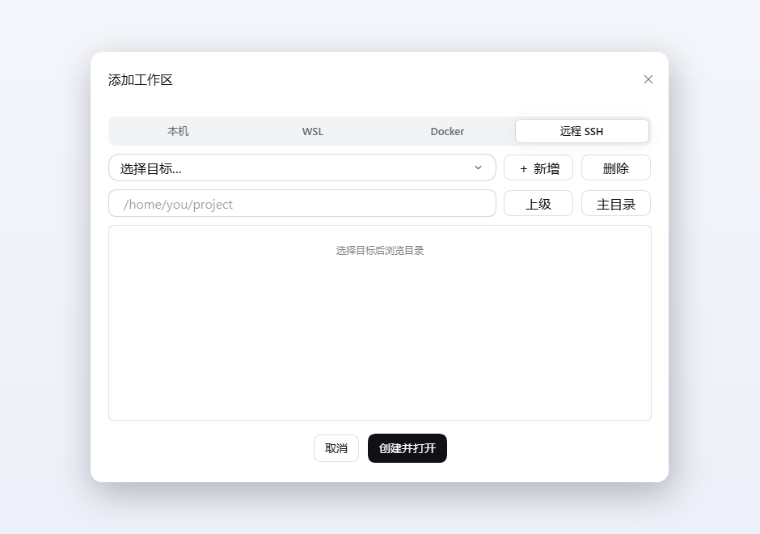
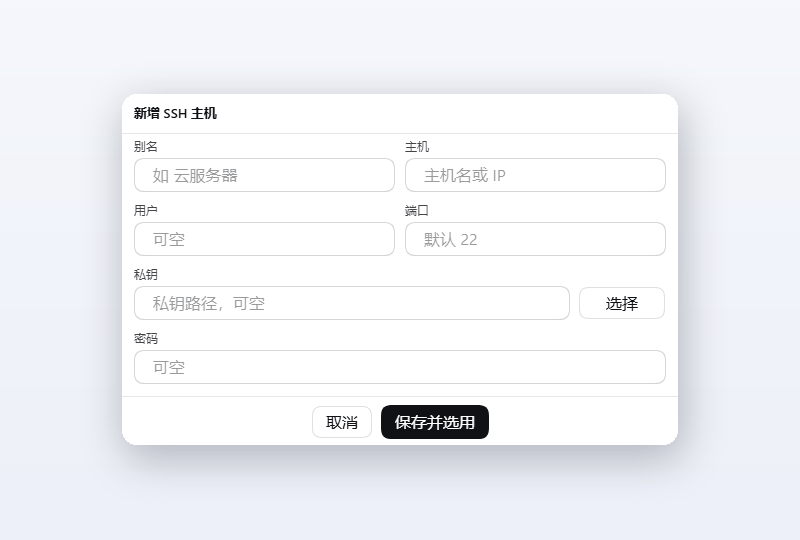

# dsh-remote-suite

[简体中文](./README.md) | English

[](https://www.npmjs.com/package/@lylgj/dsh-remote-suite)
[](./LICENSE)



**Local, WSL, SSH and Docker workspaces in DeepSeek Harness.** Browse files, edit code, open terminals and let your agent run commands through one `remote` tool.

## Screenshots

<p>
  
  
</p>
<p>
  
  
  
</p>

## Features

- **One workspace picker** — select a local directory, WSL distribution, Docker container or SSH host.
- **Workspace files** — expand folders, preview and edit files, save, create, rename, delete, search, upload and download. Includes syntax highlighting, multi-selection, context menus and paged viewing for large files.
- **Remote workbench** — a file tree, tabbed editor, terminal and port forwarding in one workspace, with light and dark themes.
- **Agent tools** — use `remote` to execute commands, read and write files, search and synchronize local mirrors across targets.
- **SSH connections** — use existing SSH config or add hosts in the UI; supports private keys, ssh-agent, passwords and ProxyJump.
- **Persistent sessions and mirrors** — daemon targets preserve shell state; pull remote directories locally or push local changes back when needed.

## Installation

Requires **DSH 0.2.2-rc.1+** running on **Node.js 20+**. Desktop normally provides its own runtime; a separate Node.js installation is not usually needed. WSL, Docker and SSH features require their respective environments and access permissions.

### DSH Desktop

Open **Plugins → Add plugin**, enter the package name, install, then fully restart DSH:

```text
@lylgj/dsh-remote-suite
```

### dsh web

```sh
dsh plugin --profile web add @lylgj/dsh-remote-suite
```

Replace `web` with your actual profile name and restart that DSH instance. Desktop users should install through the app's plugin manager.

For the latest repository changes, you can also enter this address in **Add plugin**:

```text
https://github.com/Lylgj/dsh-remote-suite
```

The npm release and GitHub default branch may contain different versions.

## Quick start

1. Click **＋** beside the workspace list and choose Local, WSL, Docker or SSH.
2. Select an existing SSH host or add one with its hostname, user and authentication details.
3. Choose a directory and open the workspace. Use **Files** in the right sidebar to browse and edit, or **Remote** in the left sidebar to open the workbench.
4. Ask your agent to work on the target:

```text
List the available remote targets.
Run npm test in /srv/app on ssh:my-server.
Find files containing TODO in this workspace.
```

## Notes

- SSH file access is provided by the plugin, not a system-wide mounted drive. Use mirror synchronization for applications that only read local files.
- SSH authentication does not support interactive one-time-code prompts.
- Direct Docker filesystem paths depend on Docker Desktop on Windows; other environments use mirrors and remote file operations.
- Stored passwords are local credentials, not an encrypted vault. Protect the DSH data directory and its backups.
- File deletion, overwrites and mirror pushes affect the real target. Confirm the target and path before proceeding.

For target parameters, authentication, mirrors, port forwarding and troubleshooting, see the [user guide (Chinese)](./docs/使用指南.md).

## FAQ

**The entry is missing after installation.**
Check that you installed into the profile you are using, then fully quit and reopen DSH. Desktop users should install through the app.

**SSH works, but another application cannot see remote files.**
The plugin accesses remote files directly without a system-wide mount. Synchronize a mirror for applications that need local files.

**The npm version differs from the repository screenshots or features.**
npm contains published releases; the default GitHub branch may include unreleased changes. Check the installed version and source.

## Uninstall

In DSH Desktop, find the plugin on the **Plugins** page, choose **Uninstall**, then fully quit and reopen DSH.

For CLI installations, remove it from the same profile used for installation:

```sh
dsh plugin --profile web remove @lylgj/dsh-remote-suite
```

Replace `web` with your actual profile name, then restart that DSH instance.

## License

[MIT](./LICENSE). See [third-party notices](./THIRD-PARTY-NOTICES.md) for bundled components.
