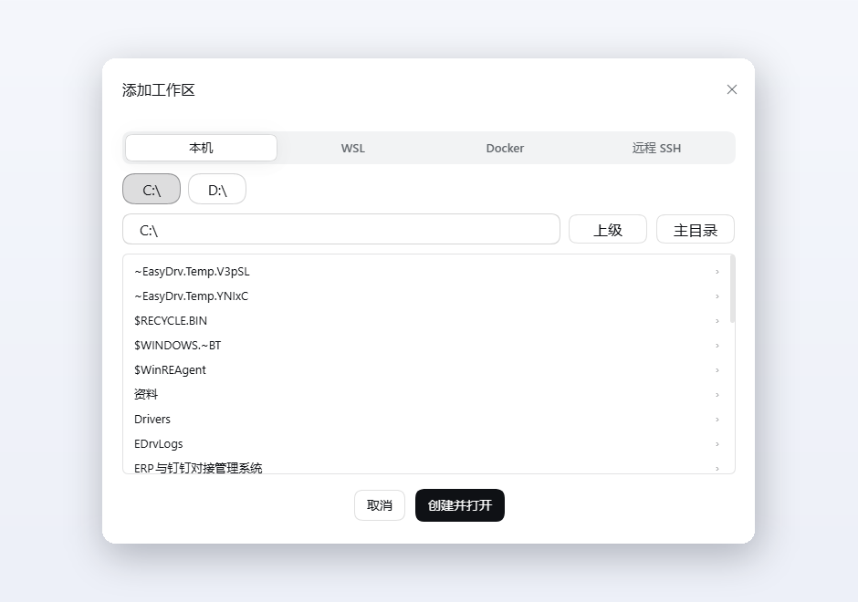

<div align="center">


# 🧭 dsh-remote-suite

**Local, WSL, SSH and Docker workspaces in one list.**

Adding a workspace in DeepSeek Harness gains four tabs: local, WSL, Docker and remote SSH. Once a directory is picked it is an ordinary
workspace — browse and edit files in the right sidebar, open a terminal, and let the agent drive every target through one `remote` tool.

[](https://www.npmjs.com/package/@lylgj/dsh-remote-suite)
[](https://www.npmjs.com/package/@lylgj/dsh-remote-suite)
[](./LICENSE)
[](https://github.com/topics/dsh-plugin)
[](https://nodejs.org/)

[简体中文](README.md) · [English](README.en.md)

```sh
dsh plugin --profile web add @lylgj/dsh-remote-suite
```

</div>

> **Repository**: [Lylgj/dsh-remote-suite](https://github.com/Lylgj/dsh-remote-suite) · **npm**: [@lylgj/dsh-remote-suite](https://www.npmjs.com/package/@lylgj/dsh-remote-suite) · **License**: MIT

## Interface

<p>
  
  
</p>
<p>
  
  
  
</p>

## Installation

Requires **DSH 0.2.2-rc.1 or newer**. The plugin runs on Node.js 20+, which the desktop app already provides.
WSL, Docker and SSH each need their own environment and access rights.

### 1. Desktop app (recommended)

Open **Plugins → Add plugin**, enter the package name, install, then **fully quit DSH and start it again** (reloading the page is not enough):

```text
@lylgj/dsh-remote-suite
```

### 2. Command line (dsh web or a custom profile)

```sh
dsh plugin --profile web add @lylgj/dsh-remote-suite
```

Replace `web` with the profile you actually use, then restart that DSH instance.

### 3. Latest code from GitHub

Use the repository URL in **Add plugin**, or run:

```sh
dsh plugin --profile web add github:Lylgj/dsh-remote-suite
```

GitHub addresses bypass the npm registry and need a working connection or proxy. The npm release and the default branch may differ.

### 4. From source

```sh
git clone https://github.com/Lylgj/dsh-remote-suite.git
dsh plugin --profile web add "file:D:/path/to/dsh-remote-suite"
```

The local path must be absolute. Installation copies the directory, so reinstall after changing the source.

### Upgrade and uninstall

```sh
dsh plugin --profile web add @lylgj/dsh-remote-suite@latest   # upgrade
dsh plugin --profile web remove @lylgj/dsh-remote-suite       # uninstall
```

The desktop app can also check for updates or uninstall from the **Plugins** page.

## First run

1. Click **＋** next to the workspace list and pick a target type.
2. Fill in the fields for that type:

| Target | Fields |
| --- | --- |
| Local | Directory (and optionally a drive) |
| WSL | Distribution + directory |
| Docker | Container (running ones are listed) + directory |
| Remote SSH | An existing host, or add one: alias, host, port, user, key / password |

3. Pick a directory and open the workspace. The sidebar's **Files** tab is the remote directory; **Remote** in the left rail opens the workbench.
4. Or just talk to the agent:

```text
List the available remote targets.
Run npm test in /srv/app on ssh:my-server.
Find the files in this workspace that contain TODO.
```

## Files in the sidebar

The built-in "workspace files" panel in the right sidebar is taken over by this plugin, so local, WSL, SSH and Docker workspaces share one UI.

- **Browse**: directories expand inline, files are tinted by type; clicking a text file opens it for editing.
- **Edit**: syntax highlighting and line numbers, `Ctrl/Cmd+S` to save (with `expectedMtimeMs` conflict detection), `Ctrl/Cmd+F` to find.
- **Manage**: create files and folders, rename, delete, multi-select and a context menu.
- **Transfer**: drag or pick files to upload; download single files, or a directory as a zip.
- **Large files**: text above 5 MiB is read in 128 KiB pages.
- **Live refresh**: the listing reloads when the directory changes.

The interface is mounted at both `/remote-suite/sidebar` and `/sidebar/api/*`, with local and remote paths served by the same methods.

## Terminal in the sidebar

The built-in terminal in the right sidebar is taken over the same way: one terminal per session, for cmd, PowerShell, WSL, SSH and Docker.

- Shells run in a detached background process, so switching tabs and coming back keeps the connection.
- A remote workspace gets the remote shell, started in the workspace directory.
- Long output is rendered with WebGL; browsers without support fall back to the plain renderer, so nothing breaks.
- Up to 10 sessions per environment; the least recently used one is recycled beyond that.
- The panel copy follows the interface language, in Chinese and English alike.

## Pane takeover

Settings → **Pane takeover** has two switches, both on by default:

- **Take over the file pane**: the sidebar file panel comes from this plugin.
- **Take over the terminal pane**: the sidebar terminal comes from this plugin.

Turning one off hands that pane back to the DSH built-in. If another plugin already holds the same pane, the takeover switches itself off and names the current holder; open it again after removing that plugin.

## Remote workbench

Open it from **Remote** in the left rail; the light/dark theme follows the interface:

- File tree, tabbed editor, embedded terminal
- Port forwarding (create, list, close)
- Mirror sync (pull, push, `dryRun`, `force`)
- Target and workspace management

## The `remote` tool

The agent drives every target through one tool with 22 actions:

| Group | Actions |
| --- | --- |
| Targets and workspaces | `targets`, `workspaces`, `workspace-add`, `workspace-remove` |
| Execution | `exec`, `probe` |
| Files | `read`, `write`, `edit`, `stat`, `list`, `mkdir`, `rename`, `remove` |
| Search | `grep`, `glob` |
| Credentials | `secret-set`, `secret-remove` |
| Mirrors | `mirrors`, `mirror-add`, `mirror-remove`, `mirror-sync` |

Defaults: `exec` times out after 120 seconds and truncates output at 64 KB; `grep` returns at most 100 matches and `list` at most 500 entries; `edit` requires `old` to match exactly once.

## SSH

- Reuses hosts from `~/.ssh/config`, or add new ones in the UI (aliases may be any language).
- Authentication tries key (with passphrase) → ssh-agent → password.
- ProxyJump chains are supported; host records live in the DSH data directory.
- A password can come from an environment variable instead of the config file.

## Docker

- Running containers are listed and picked directly.
- With Docker Desktop, the workspace uses the container's real file paths, so what you see matches the container.
- When a container stops, the workspace falls back to a local mirror and works again once it starts.

## Mirror sync

A remote directory can be mapped to a local copy at `$DSH_HOME/remote-suite/mirrors/<target>/<name>`:

- `mirror-sync` defaults to `pull`; `push` refuses to overwrite files that are newer on the remote unless `force` is set.
- Transfers use 32 KiB chunks, so large files are not read into memory at once; files of equal size whose mtimes differ by less than 2 seconds count as unchanged.
- `dryRun` reports differences without writing.

## Port forwarding

Create a local-to-remote forward from the workbench or the API — handy for reaching a web service running on the remote host; the list shows active forwards and can close them at any time.

## Configuration and data

| Location | Contents |
| --- | --- |
| `$DSH_HOME/remote-suite/state.json` | Workspaces, SSH hosts, mirror records |
| `$DSH_HOME/remote-suite/mirrors/` | Local mirror directories |
| `$DSH_HOME/remote-suite/debug.log` | Diagnostic log |
| `~/.ssh/config` | Read and reused; never rewritten |

Changes take effect after reopening the workspace or restarting DSH.

## FAQ

**No entry after installing?** Check that it went into the profile you are using, then fully quit and reopen DSH.

**Code changes have no effect?** A source install is a copy; install again after editing.

**SSH works, but other apps cannot see the remote files?** The plugin talks to the remote directly and creates no system mount; sync a mirror for apps that need local files.

**Why did the shell state vanish?** Every SSH connection starts a new shell; use a daemon target to keep state.

**Why is search slow?** Search reads each file rather than using an index; narrow the directory for large repositories.

## Known limits

- SSH cannot prompt for one-time codes.
- Stored passwords are local credentials, not an encrypted vault.
- Real container file paths on Windows depend on Docker Desktop.
- Directory changes are detected by polling, so rapid writes may appear slightly late.
- Deleting, overwriting and pushing mirrors all change the real target — verify the path first.

## Security

The plugin stores SSH host records and (optionally) passwords on this machine — protect access to the DSH data directory. Remote commands run as your user on the target; destructive actions have no second confirmation, so check the target and path first.

## Versions and compatibility

- Minimum DSH requirement: `>=0.2.2-rc.1`. Current development and troubleshooting use the Windows desktop app `0.2.2-rc.5`; full functional compatibility is still being verified.
- `0.2.2-alpha.3` is incompatible. Full compatibility is not guaranteed for other releases that have not been individually tested.
- Node.js `20` and newer.
- Status: best tested on the Windows desktop app; Linux desktop and macOS are untested.

## License

MIT
