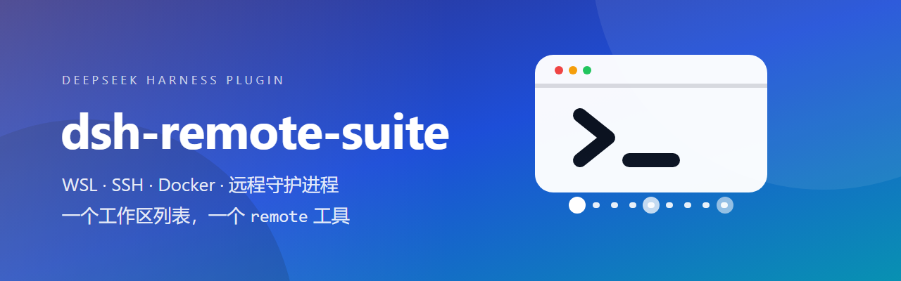
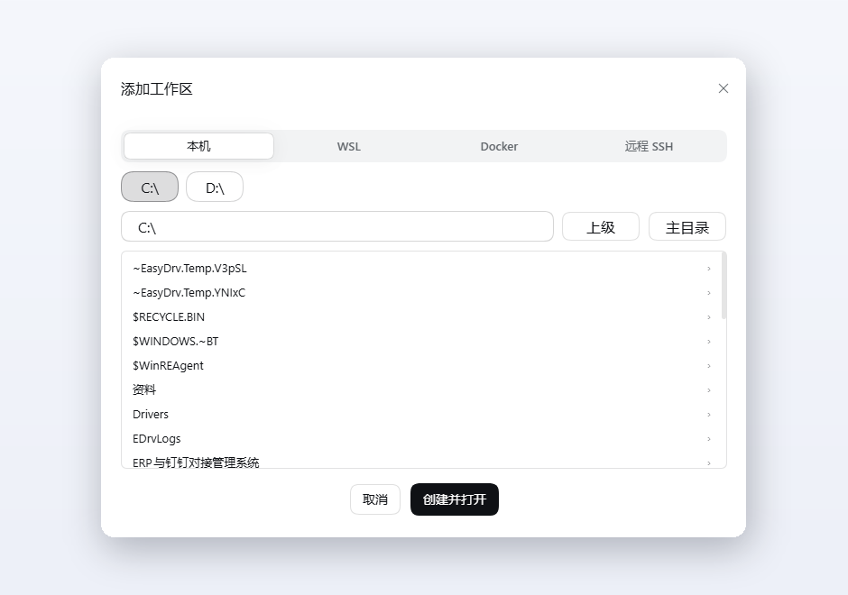
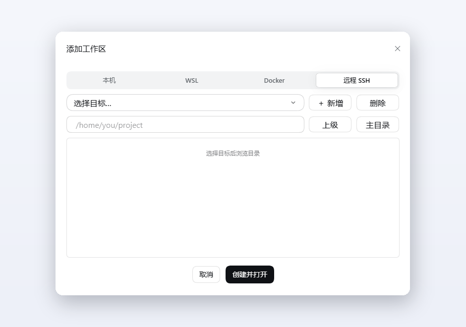
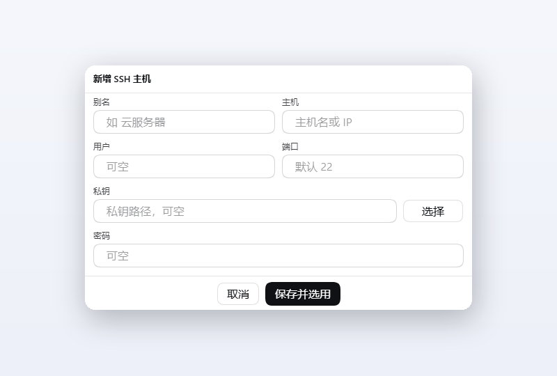

# dsh-remote-suite



[DeepSeek Harness](https://github.com/deepseek-ai/deepseek-harness) 的远程工作区插件：把**本机、WSL 发行版、
SSH 主机、Docker 容器**收进同一个「添加工作区」对话框，并用**一个 `remote` 工具**统一操作它们——
同一套参数，换目标不用换工具。

## 功能

- **四类工作区**：官方「＋ 添加工作区」对话框里多出 本机 / WSL / Docker / 远程 SSH 四个标签页；
  选好目录后就是一个普通工作区，DSH 自带的文件树、终端与 agent 都能照常使用。
- **一个工具管全部**：`remote` 有 19 个 action——执行命令、读 / 写 / 改文件、`grep`、`glob`、列目录、
  保存工作区、镜像同步——目标从 WSL 换成 Docker 或 SSH，参数写法不变。
- **远程 SSH**：主机直接读 `~/.ssh/config`，也能在对话框里新增；别名可以用中文；密钥、ssh-agent、
  密码三种认证都支持，密码单独存 `secrets.json`（0600，从不回显）。
- **多跳登录**：`ProxyJump` 支持任意跳数，别名或 `user@host:port` 都行。
- **常驻会话**：`daemon:<别名>` 让 `cd`、`export`、shell 函数跨命令保留——顺手可以在远端起一个
  `dsh web`。
- **Docker**：只依赖 `docker` CLI，Docker Desktop、`DOCKER_HOST`、`podman` / `nerdctl` 都能用。
- **WSL**：工作区落在 `\\wsl.localhost\<发行版>\<路径>`，走 DSH 原生文件树，不经过镜像。
- **镜像同步**：把远端目录拉到本地一份，供桌面编辑器、搜索和 `git` 使用；32 KB 分块传输，远端不需要
  `tar` / `rsync`，二进制文件完好。

## 界面

<p>
  
  
  
</p>

## 安装

需要 DeepSeek Harness `>= 0.2.1-rc.2`。

插件的 npm 包名是 `@lylgj/dsh-remote-suite`；下面两种装法都是让 DSH 从 npm 源拉取它。装插件要走 DSH 自己的流程（界面或 `dsh plugin`），直接 `npm install` 不会被识别成插件。

**在界面里装（推荐）**

左侧栏 →「插件」→「添加插件」，在「包名或地址」里填：

```
@lylgj/dsh-remote-suite
```

点「安装」，装完**完全重启** DeepSeek Harness（不是刷新页面）。之后每个 agent preset 会拿到 `remote`
工具，「添加工作区」换成插件的四个标签页。

**用命令行装**

```powershell
dsh plugin --profile desktop add @lylgj/dsh-remote-suite
```

npm 源不通时可以直接从仓库装（内容相同，但插件页不会显示版本更新）：

```powershell
dsh plugin --profile desktop add github:Lylgj/dsh-remote-suite
```

GitHub 地址不走 npm 源，需要本机能直连 github.com，或给 git / 终端配好代理。

**从源码装（自己改代码时）**

```powershell
dsh plugin --profile desktop add "D:\你的路径\dsh-remote-suite"
```

本地目录必须写绝对路径。这种方式装进去的是目录副本，改完源码要重装一次（或把文件同步到 profile 的
`node_modules\@lylgj\dsh-remote-suite`）再重启。

以前装过同类插件的话先在「插件」页卸载——它们会注册同名工具或抢占侧栏：
`dsh-wsl-tool`、`dsh-wsl-workspace`、`@zhangfengshun/dsh-remote-ssh`。

## 快速上手

1. 点工作区列表旁的 `＋`，选 **远程 SSH** → **＋ 新增**，填别名、主机、用户，选私钥文件，点「保存并选用」。
2. 浏览到远端目录，选中后打开——工作区就建好了。
3. 在会话里说「在服务器上跑一下测试」，agent 会自己调
   `remote action=exec target=ssh:云服务器 command="npm test"`。

字段细节、`remote` 每个 action 的参数、认证顺序、镜像与排错，见 **[使用指南](docs/使用指南.md)**。

## 许可

MIT
