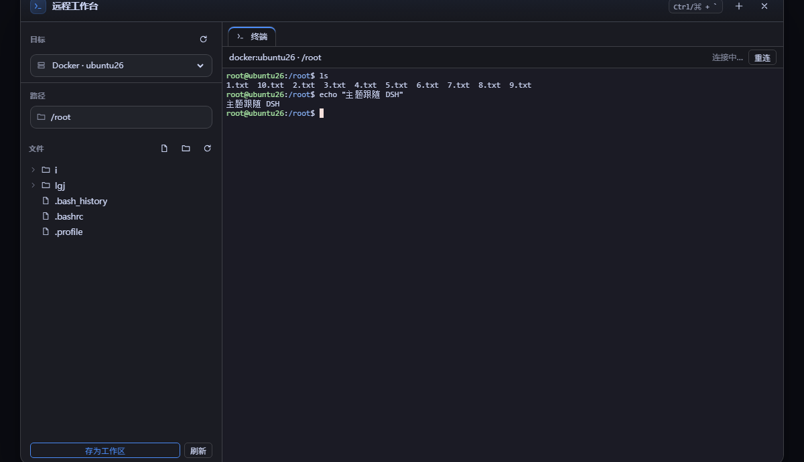
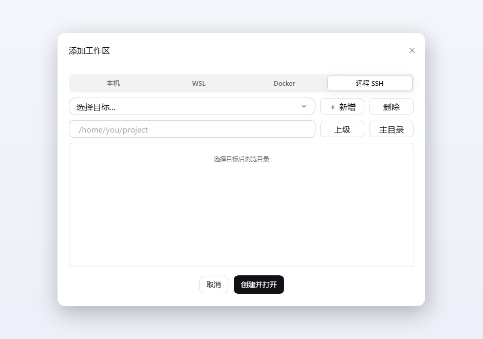

<div align="center">


# 🧭 dsh-remote-suite

**把本机、WSL、SSH、Docker 的工作区放进同一个列表。**

在 DeepSeek Harness 里添加工作区时多出四个标签页：本机、WSL、Docker、远程 SSH。选完目录就是一个普通工作区——
右侧栏能看到文件、能编辑，终端能开，Agent 能通过一个 `remote` 工具在所有目标上执行同样的操作。

[](https://www.npmjs.com/package/@lylgj/dsh-remote-suite)
[](https://www.npmjs.com/package/@lylgj/dsh-remote-suite)
[](./LICENSE)
[](https://github.com/topics/dsh-plugin)
[](https://nodejs.org/)

[简体中文](README.md) · [English](README.en.md)

```sh
dsh plugin --profile web add @lylgj/dsh-remote-suite
```

</div>

> **主仓库**：[Lylgj/dsh-remote-suite](https://github.com/Lylgj/dsh-remote-suite)　·　**npm**：[@lylgj/dsh-remote-suite](https://www.npmjs.com/package/@lylgj/dsh-remote-suite)　·　**许可**：MIT

## 界面

<p>
  
  
</p>
<p>
  
  
  
</p>

## 安装

需要 **DSH 0.2.2-rc.1 或更新版本**。插件用 Node.js 20+ 运行，桌面版通常自带，无需单独安装。
WSL、Docker、SSH 功能各自还需要准备好对应的环境与访问权限。

### 一、桌面版（推荐）

打开 **插件 → 添加插件**，输入包名，点安装，然后**完全退出 DSH 再打开**（刷新页面不够）：

```text
@lylgj/dsh-remote-suite
```

### 二、命令行（dsh web 或自定义 profile）

```sh
dsh plugin --profile web add @lylgj/dsh-remote-suite
```

把 `web` 换成你实际使用的 profile 名称，然后重启对应的 DSH 实例。

### 三、安装 GitHub 上的最新代码

在 **添加插件** 里填地址，或命令行执行：

```sh
dsh plugin --profile web add github:Lylgj/dsh-remote-suite
```

GitHub 地址不经过 npm 源，需要能直连或配置好代理。npm 发布版与默认分支不一定是同一份代码。

### 四、从源码安装

```sh
git clone https://github.com/Lylgj/dsh-remote-suite.git
dsh plugin --profile web add "file:D:/path/to/dsh-remote-suite"
```

本地路径必须是绝对路径。装进去的是副本，改完源码需要重新安装。

### 升级与卸载

```sh
dsh plugin --profile web add @lylgj/dsh-remote-suite@latest   # 升级
dsh plugin --profile web remove @lylgj/dsh-remote-suite       # 卸载
```

桌面版也可以在 **插件** 页面里检查更新或直接卸载。

## 第一次运行

1. 点工作区列表旁的 **＋**，选目标类型。
2. 按类型填字段：

| 目标 | 需要填 |
| --- | --- |
| 本机 | 目录（可选磁盘） |
| WSL | 发行版 + 目录 |
| Docker | 容器（列出运行中的）+ 目录 |
| 远程 SSH | 已有主机，或新增：别名、主机、端口、用户名、私钥 / 密码 |

3. 选定目录后打开工作区。右侧栏 **文件** 就是远端目录，左侧栏 **远程** 打开工作台。
4. 也可以直接对 Agent 说：

```text
列出可用的远程目标。
在 ssh:my-server 的 /srv/app 目录执行 npm test。
查找这个工作区里包含 TODO 的文件。
```

## 侧栏「文件」

官方右侧栏的「工作区文件」在装好本插件后由插件接管，本机、WSL、SSH、Docker 工作区都是同一套界面。

- **浏览**：目录内联展开，文件按类型着色；点开文本文件即进入编辑。
- **编辑**：语法高亮、行号，`Ctrl/Cmd+S` 保存（带 `expectedMtimeMs` 冲突检测），`Ctrl/Cmd+F` 查找。
- **管理**：新建文件/目录、重命名、删除，支持多选与右键菜单。
- **传输**：拖拽或选择文件上传；单文件下载，目录可打包成 zip。
- **大文件**：超过 5 MiB 的文本以 128 KiB 分页读取。
- **实时刷新**：目录变化后自动重载列表。

接口挂在 `/remote-suite/sidebar` 与 `/sidebar/api/*` 两处，本机与远端走同一套方法。

## 侧栏「终端」

官方右侧栏的终端同样由本插件接管，一个会话一个终端，cmd、PowerShell、WSL、SSH、Docker 都能开：

- 终端跑在独立的后台进程里，页签切走再回来连接还在。
- 远端工作区直接用远端 shell，`cd` 到工作区目录。
- 长输出用 WebGL 渲染（浏览器不支持时自动退回普通渲染，不影响使用）。
- 每个环境最多 10 个会话，超出后回收最久未用的。
- 面板文案跟随界面语言，中英文都可用。

## 接管设置

设置 → **接管设置** 里有两个开关，默认都打开：

- **接管工作区文件**：右侧栏的「文件」面板由本插件提供。
- **接管终端**：右侧栏的「终端」面板由本插件提供。

关掉哪一项，哪一项就还给 DSH 自带的实现。如果同一个面板已经被别的插件占着，接管会自动关闭并显示当前接管者；卸掉那个插件后手动打开即可。

装了 `dsh-better-sidebar` 时，文件面板由它显示（不再报「already registered」的错），文件数据仍由本插件提供；终端面板依旧是本插件的。卸掉它重启后文件面板自动接管回来。

因为终端已经并进来，`@lylgj/dsh-terminal` 建议卸掉：它和本插件抢同一个「终端」页签，先注册的那个生效，输的那个在控制台报错。卸载后重启即可。

## 远程工作台

左侧栏 **远程** 打开，浅色/深色主题随界面切换：

- 文件树、多页签编辑器、内嵌终端
- 端口转发（新建、列出、关闭）
- 镜像同步（拉取、推送、`dryRun`、`force`）
- 目标与工作区管理

## `remote` 工具

Agent 通过一个工具操作所有目标，共 22 个 action：

| 分组 | action |
| --- | --- |
| 目标与工作区 | `targets`、`workspaces`、`workspace-add`、`workspace-remove` |
| 执行 | `exec`、`probe` |
| 文件 | `read`、`write`、`edit`、`stat`、`list`、`mkdir`、`rename`、`remove` |
| 搜索 | `grep`、`glob` |
| 凭据 | `secret-set`、`secret-remove` |
| 镜像 | `mirrors`、`mirror-add`、`mirror-remove`、`mirror-sync` |

默认行为：`exec` 超时 120 秒、输出截断 64 KB；`grep` 最多 100 条、`list` 最多 500 条；`edit` 要求 `old` 唯一匹配。

## SSH

- 直接复用 `~/.ssh/config` 里的主机，也可以在界面里新增（支持中文别名）。
- 认证依次尝试：私钥（含口令）→ ssh-agent → 密码。
- 支持 ProxyJump 多跳；主机信息保存在 DSH 数据目录。
- 密码可以用环境变量提供，避免写进配置文件。

## Docker

- 列出运行中的容器，直接选。
- Docker Desktop 运行时，工作区拿到的是容器内真实文件的路径，看到的与容器里一致。
- 容器停止后回退为本地镜像目录，重新启动后继续可用。

## 镜像同步

远端目录可以映射成 `$DSH_HOME/remote-suite/mirrors/<目标>/<目录名>` 的本地副本：

- `mirror-sync` 默认 `pull`，`push` 会拒绝覆盖远端更新的文件，除非显式 `force`。
- 分块 32 KiB，大文件不会一次性读入内存；同大小且 mtime 相差 2 秒内的文件视为未变。
- `dryRun` 只报告差异，不写盘。

## 端口转发

在工作台或通过接口建立本地到远端的端口转发，常用于访问远端开发服务器上的 Web 服务；转发列表可以看到当前活动连接，并随时关闭。

## 配置与数据

| 位置 | 内容 |
| --- | --- |
| `$DSH_HOME/remote-suite/state.json` | 工作区、SSH 主机、镜像记录 |
| `$DSH_HOME/remote-suite/mirrors/` | 本地镜像目录 |
| `$DSH_HOME/remote-suite/debug.log` | 诊断日志 |
| `~/.ssh/config` | 只读复用，不会改写 |

改配置后需要重新打开工作区或重启 DSH 才生效。

## 常见问题

**装完没有入口？** 确认装进了当前使用的 profile，并完全退出 DSH 再打开。

**改了代码没生效？** 本地源码安装是副本，改完要重新安装一次。

**SSH 连上了，别的软件看不到远端文件？** 插件直接访问远端，不创建系统挂载；需要本地文件的软件请先同步镜像。

**终端里的 shell 状态为什么丢了？** SSH 目标每次连接都是新 shell，需要保留状态请用 daemon 目标。

**为什么搜索很慢？** 搜索逐个文件读取内容，不是索引；大仓库建议缩小目录范围。

## 已知限制

- SSH 不支持交互式输入一次性验证码。
- 保存的密码是本机凭据，不是加密保险库。
- Windows 上的 Docker 真实文件路径依赖 Docker Desktop。
- 目录变更靠轮询感知，密集写入时刷新会略滞后。
- 删除、覆盖、镜像 push 都会改变真实目标，操作前先确认路径。

## 安全

插件会在本机保存 SSH 主机配置与（可选的）密码，请保护好 DSH 数据目录。远端命令以你的用户在目标机器上执行，删除、擦除、覆盖类操作没有二次确认，请先核对目标与路径。

## 版本与兼容性

- DSH `0.2.2-rc.1` 起；`0.2.2-alpha.3` 不兼容，`0.2.2-rc.2` 未验证。
- Node.js `20` 起。
- 状态：Windows 上的桌面版验证最充分；Linux 桌面、macOS 未逐一验证。

## 许可

MIT
