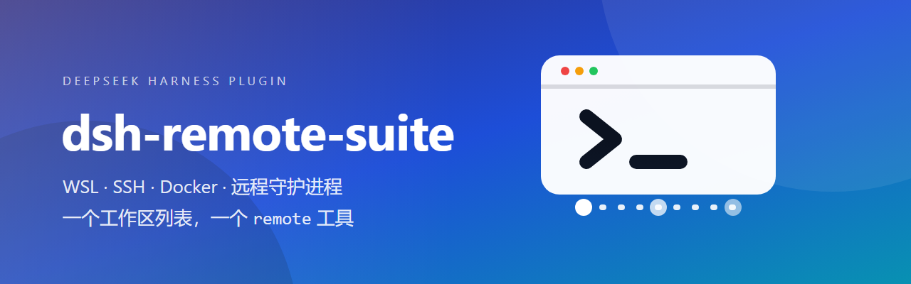
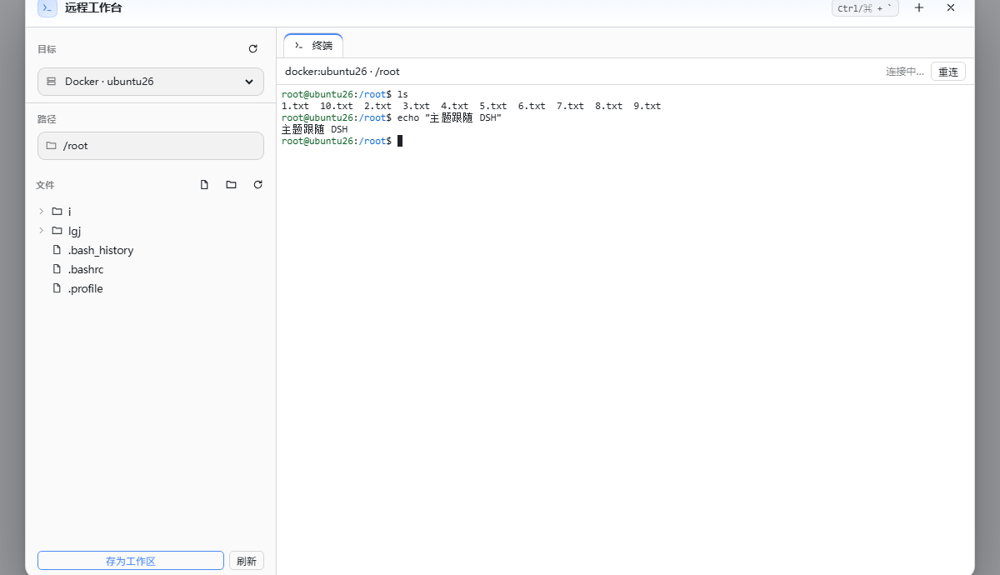
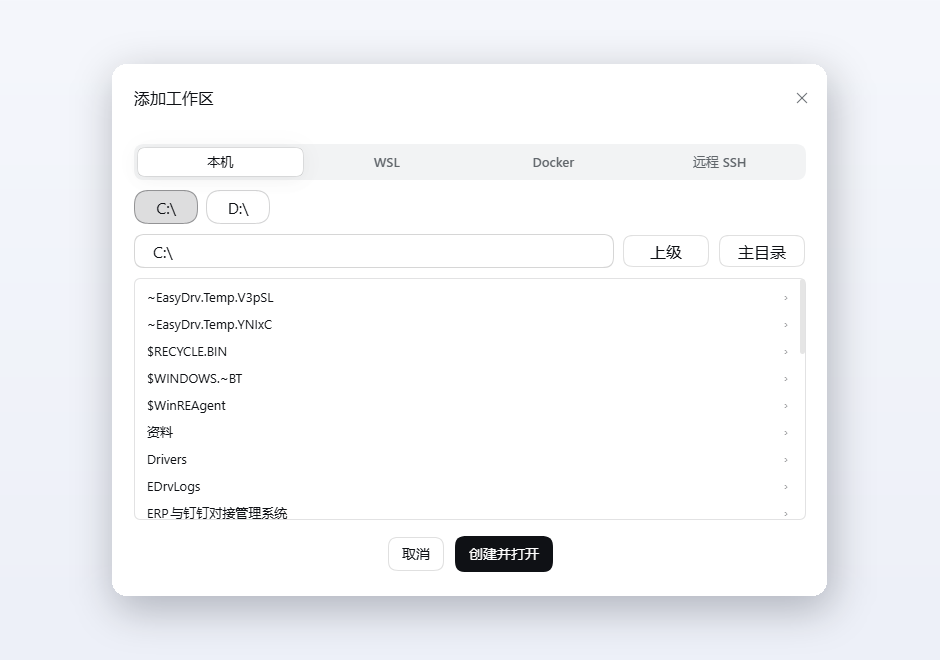
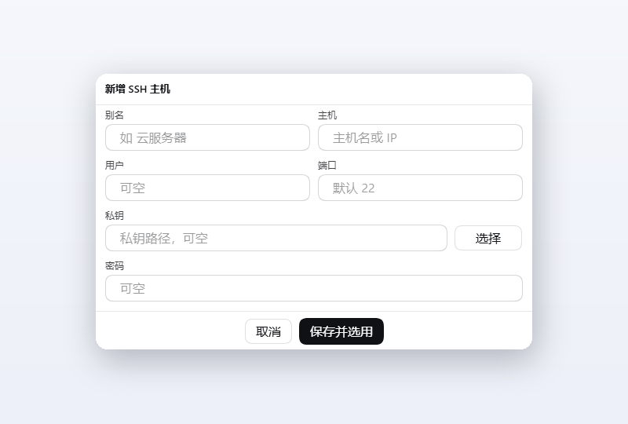

# dsh-remote-suite

简体中文 | [English](./README.en.md)

[](https://www.npmjs.com/package/@lylgj/dsh-remote-suite)
[](./LICENSE)



**在 DeepSeek Harness 中统一使用本机、WSL、SSH 和 Docker 工作区。** 浏览文件、编辑代码、打开终端，让 Agent 通过一个 `remote` 工具执行命令。

## 界面预览

<p>
  
  
</p>
<p>
  
  
  
</p>

## 功能

- **统一选择工作区**：在同一个入口中选择本机目录、WSL 发行版、Docker 容器或 SSH 主机。
- **工作区文件**：展开目录、预览和编辑文件、保存、新建、重命名、删除、搜索、上传下载；支持语法高亮、多选、右键菜单和大文件分页查看。
- **远程工作台**：文件树、多页签编辑器、终端和端口转发集中在一个工作台中，支持浅色和深色主题。
- **Agent 工具**：通过 `remote` 跨目标执行命令、读写文件、搜索和同步本地镜像。
- **SSH 连接**：使用已有 SSH 配置或在界面中添加主机，支持私钥、ssh-agent、密码和 ProxyJump。
- **常驻会话与镜像**：daemon 目标保留 shell 状态；按需将远端目录拉到本地，或把本地改动推回远端。

## 安装

需要 **DSH 0.2.2-rc.1+**；运行插件的 Node.js 需为 **20+**（桌面版通常由应用提供，无需单独安装）。使用 WSL、Docker、SSH 功能前，需准备对应环境和访问权限。

### DSH 桌面版

打开 **插件 → 添加插件**，输入包名并安装，然后完全退出并重新打开 DSH：

```text
@lylgj/dsh-remote-suite
```

### dsh web

```sh
dsh plugin --profile web add @lylgj/dsh-remote-suite
```

将 `web` 换成实际使用的 profile 名称，然后重启对应 DSH 实例。桌面版请通过应用内的插件管理器安装。

需要仓库中的最新改动时，也可在 **添加插件** 中输入：

```text
https://github.com/Lylgj/dsh-remote-suite
```

npm 发布版与 GitHub 默认分支可能包含不同版本。

## 快速开始

1. 点击工作区列表旁的 **＋**，选择本机、WSL、Docker 或远程 SSH。
2. 选用已有 SSH 主机，或填写主机地址、用户及认证信息添加主机。
3. 选择目录并打开工作区。在右侧栏 **文件** 中浏览和编辑，或点击左侧栏 **远程** 打开工作台。
4. 在对话中让 Agent 操作目标：

```text
列出可用的远程目标。
在 ssh:my-server 的 /srv/app 目录执行 npm test。
查找这个工作区中包含 TODO 的文件。
```

## 使用提示

- SSH 文件访问由插件提供，不是系统级磁盘挂载。其他只读取本地文件的软件需要先同步镜像。
- SSH 认证不支持交互输入一次性验证码。
- Docker 文件系统路径直连依赖 Windows 上的 Docker Desktop；其他环境使用镜像和远端文件操作。
- 保存的密码是本机凭据，并非加密保险库。请保护 DSH 数据目录及备份的访问权限。
- 删除文件、覆盖写入和镜像 push 会改变真实目标，请先确认目标和路径。

目标参数、认证配置、镜像、端口转发与排错详见 [使用指南（中文）](./docs/使用指南.md)。

## 常见问题

**安装后没有出现入口？**
确认安装到了当前使用的 profile，完全退出 DSH 后重新打开；桌面版优先使用应用内安装。

**SSH 登录成功，但其他软件看不到远端文件？**
插件文件面板直接访问远端，不会创建系统级挂载；需要本地文件的软件请先同步镜像。

**npm 安装后与仓库截图或功能不同？**
npm 对应已发布版本，GitHub 默认分支可能包含尚未发布的改动，请先核对版本与安装来源。

## 卸载

在 DSH 桌面版的 **插件** 页面找到本插件，选择 **卸载**，然后完全退出并重新打开 DSH。

使用 CLI 时，在安装插件的同一个 profile 中执行：

```sh
dsh plugin --profile web remove @lylgj/dsh-remote-suite
```

将 `web` 换成实际 profile 名称，然后重启对应 DSH 实例。

## 许可

[MIT](./LICENSE)。内置组件的版权与许可见 [第三方声明](./THIRD-PARTY-NOTICES.md)。
